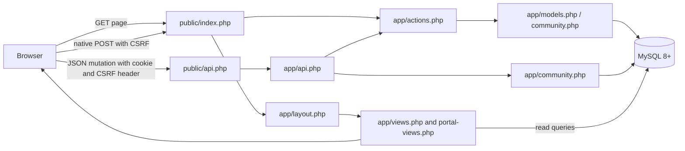
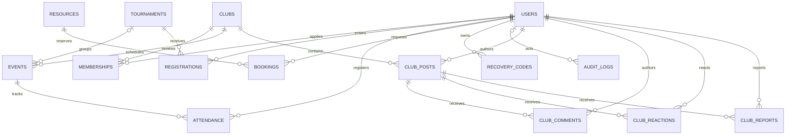

# Architecture - one native PHP application

This package preserves the existing server-rendered architecture. PHP produces the HTML; CSS and vanilla JavaScript provide presentation and progressive enhancement. There is no frontend build or framework runtime. MySQL stores relational data. PHP extensions supply PDO, text handling, encryption and password hashing.

## Request flow

`public/index.php` allowlists pages, handles native writes, checks authentication/admin access and renders the layout. `app/views.php` emits public/account/activity/admin management markup, delegating portal branches to `app/portal-views.php`. `app/ui.php` supplies escaped UI helpers. A native successful command returns a flash message and HTTP 303 redirect.

`public/api.php` sets up the REST entry and catches exceptions without disclosing SQL/stack traces. `app/api.php` checks methods, JSON shape/size, cookie session, CSRF header, Origin and allowed fields, then calls the same actions/services. `app.js` enhances known forms into `fetch` requests and follows returned redirect metadata. Unknown forms retain native behavior. JavaScript disabled does not disable server security or ordinary form actions.

`app/bootstrap.php` loads this package's private configuration, establishes PDO using native prepared statements, checks the MySQL engine/version, sets Asia/Colombo/+05:30 time, and provides escaping, validation, authorization and session/CSRF helpers. `app/security.php` contains TOTP, encryption, replay/recovery verification, rate limiting and login completion.

## Source map

| Directory / file | Responsibility |
|---|---|
| `public/` | Only HTTP document root; entrypoints and static assets |
| `app/` | Private configuration/helpers, domain services, page fragments and REST implementation |
| `database/schema.sql` | Core relational tables and invariants |
| `database/migrations/` | Additive community schema versions |
| `bin/setup.php` | Creates private `.env` once with random key |
| `bin/migrate.php` | Ensures schema and applies unapplied versions under advisory lock |
| `bin/seed.php` | Optional fictional development sports records, no shared logins |
| `bin/create-admin.php` | Private CLI administrator provisioning from process environment |
| `bin/doctor.php` | Checks PHP/extensions/key/database/schema/session readiness |
| `tests/` | PHP security and optional isolated HTTP/MySQL functional verification |
| `docs/` | Self-contained instructions and truthful evidence records |

No `require` path should leave this package. Paths based on the package's own `ROOT` keep its configuration/session data separate from the parent prototype. The local default web port is 8091; tests use a different port and disposable schema.

## Data model

Operational `login_attempts` stores throttle buckets without a user foreign key; `schema_migrations`, created by the migration CLI, tracks applied filenames. These tables do not represent student participation and therefore are described separately from the domain diagram.

- Unique user/club, user/tournament and user/event pairs prevent duplicate memberships/registrations/attendance. Rejected memberships may reapply to pending through the existing service.
- One event belongs to one club and optionally one tournament. Tournament registration does not automatically enroll a player into each event. Attendance status distinguishes `registered` from `attended`.
- Scores require a match, opponent label and paired nonnegative values. Standings aggregate recorded club matches using 3/1/0 points. The opponent is text; automated brackets and sport-specific tie-breaks are not implemented.
- Resources represent single reservable units. Pending/approved bookings block overlaps. Adjacent intervals are permitted by strict overlap comparisons.
- Community reactions have one user/post pair; reports have one user/post pair. Approved membership in the exact club or admin role permits private content. Moderation reasons and report details are private to administrators.
- Foreign-key cascades can remove linked participation when an admin deletes a parent record. Do not treat Delete as reversible archival. Tournament deletion sets related event tournament references to null where defined; audit actor deletion preserves logs with a null actor.

## Transactions and state

Enrollment and booking operations serialize using parent rows and `SELECT ... FOR UPDATE`; capacity/overlap/duplicate checks happen before committing. Membership/booking decisions reread pending state under lock. Own cancellation checks account ownership, eligibility and time; bookings retain cancelled records while some participation cancellations delete their relation rows.

Community writes use READ COMMITTED plus locked parent post state. Editing a hidden post changes its body without restoring visibility. Hide/restore is an admin decision with reason and audit. Deletion erases body and dependent comments/reactions/reports while retaining a non-restorable tombstone ID. These distinctions must survive UI or documentation changes.

Migration DDL may auto-commit in MySQL. Retry-safe additive statements and recorded versions provide controlled repeatability, not a promise that arbitrary schema changes can be rolled back transactionally. Keep a backup before changes to a valued database.
